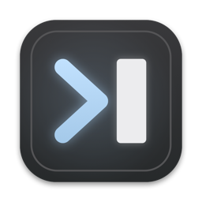

# the-great-gui

A native Mac manager for your terminal commands, drawn with the ds-next terminal design system.
One registry of commands to browse, pick and run; secrets in the macOS Keychain; an embedded
terminal for the interactive ones. Swift and SwiftUI, built with the command-line tools alone and
edited in VS Code. Xcode is optional.

Owner: ckoenigs · status: **one look**. The window lists your commands from `commands.toml`, runs a plain
one with its output streaming, runs an interactive one in an embedded terminal, feeds Keychain secrets into
a command's environment, and asks for Touch ID before a gated command. It is a native macOS 26/27 window
in the ds-next theme (dark, the one it starts in) or Paper and Ink; the terminal look and its gallery were removed on 2026-11-13
(DECISIONS local-032). Open items: `DECISIONS.md`. To implement next: team tooling, a shared registry and registered installs (`docs/team-tooling.md`).

## Install

One command, once, in a terminal. No Apple account, no App Store: the app is built on the Mac it runs
on, from this repository, with Apple's free command-line tools. `ADDRESS` is the git address you were
given for it; nothing here names a host.

```sh
git clone ADDRESS ~/Developer/the-great-gui && ~/Developer/the-great-gui/scripts/install.sh
```

If `git` itself offers to install the command line developer tools, approve that, wait for it to finish,
and run the line again. The build fetches its Swift packages from github.com, read-only and with no
sign-in, so the Mac must be able to reach it.

The installer installs the command-line tools if the Mac has none (a dialog to approve), the design's
typeface through Homebrew when Homebrew is there, builds the app, links `great-gui` into `~/.local/bin`,
the `add-command` skill into whichever agents are installed, and the app into `~/Applications` so
Spotlight finds it, makes `~/.great-gui` a git repository, and opens the app. Two minutes the first time.
From then on the app updates itself: **the-great-gui › Update…** in its menu (see Updating). The terminal
is not needed again.

The clone needs read access to the repository on whichever host serves it, signed in the way that host
asks. HTTPS rather than SSH because office networks often close port 22. If `~/.local/bin` is not on
PATH the installer offers to add it, since the agents' skills call `great-gui` by name. To use an
existing registry instead of the example the app writes, clone it to `~/.great-gui` before the first
launch.

### On a git host of your own

Nothing in the app or its installer names a host, so a team runs all of it from its own git. One person
who can reach this repository carries it across. The others need only read access to github.com for the
Swift packages the build fetches.

```sh
make mirror TO=ADDRESS    # once: ADDRESS is an empty repository you created on your host
make mirror               # afterwards: pull what is new here, push it there
scripts/mirror.sh --where # where the mirror is, and whether it is behind
```

It pulls this checkout from where it came from and pushes the same branch and tags to the mirror, and
prints the line a teammate installs with (`git clone ADDRESS … && …/scripts/install.sh`). Their copy
then looks for updates on your host, because an install follows whatever it was cloned from. A new
version reaches them when you run `make mirror` again; add it to your own commands with a schedule and
it happens by itself.

The team's registry moves the same way, with plain git: in its folder, `git remote set-url origin
ADDRESS && git push -u origin main`, then `great-gui team join ADDRESS` on each Mac. A personal registry
(`~/.great-gui`) is a git repository with no remote until you give it one; it never needs one.

Needs macOS 26 and the Xcode command-line tools (`xcode-select --install`; no Apple ID), or Xcode. In
VS Code, install the recommended Swift extension when prompted; `.vscode/` has build, test, run and
snapshot tasks and a debug launch.

One rule keeps the command-line-tools build working: **no `@State`**. On the macOS 26 SDK, `@State` is a
compiler macro whose plugin ships only inside Xcode; every other wrapper (`@Environment`, `@AppStorage`,
`@StateObject`, `@Observable`, `@Binding`, `@FocusState`) compiles with the tools alone. View state goes in
a small `@Observable` or `ObservableObject` model held by `@StateObject` (see `Term`).

| Command | Does |
|---|---|
| `scripts/install.sh` | everything below for a Mac that has nothing yet; safe to run again |
| `make install` | release build, `~/.local/bin/great-gui` → `bin/great-gui`, skills linked into the agents, `~/Applications/the-great-gui.app` → the build |
| `make update` | pull this checkout, `make install`, and quit and reopen the app if it was running |
| `make uninstall` · `make skills` | unlink the command and the skills · relink the skills |
| `make build` / `make test` | debug build; the tests (`swift build`, `swift test`) |
| `make check` | tests, and `Tokens.swift` agrees with canon's terminal design `tokens.json` |
| `make tokens` | regenerate `Sources/TerminalDesign/Tokens.swift` from a new design export |
| `make app` | release build wrapped as `build/the-great-gui.app`; `SIGN_IDENTITY="…" make app` signs with a named certificate |
| `assets/make-icon.sh` | redraw the app icon from `assets/make-icon.swift` (only after changing the artwork) |
| `make snapshot` | draw the window's screens to `build/snapshots/*.png`, both themes, light and dark, from the example registry; nothing of yours is read (the sidebar's rows and glass controls do not draw off screen) |

## Updating

The app looks for a newer version once a day and installs nothing by itself. When the repository this
copy was built from has something new, **Update available** appears at the foot of the sidebar with the
number of changes; hover for what they are, click to
update. The look is a quiet `git fetch` when the app starts and when it comes forward after a day; it
never asks for a password, so a Mac that is offline or has no access simply shows nothing. Settings (⌘,)
has the switch, the last result and Check Now; the app menu has Check for Updates; `great-gui
update-check` is the same from a terminal (exit 10 when something is waiting).

The app runs from `build/the-great-gui.app` inside the checkout; the `great-gui`
command and the skills are symlinks into it, so they follow a pull on their own, and the bundle needs a
rebuild. One step does it all:

```sh
make update        # pull, rebuild and relink, then quit and reopen the app if it was running
```

The same is in the app menu as **Update…**: it runs `make update` in an embedded terminal, in a
sheet, and, when the script finishes, the window closes and comes
back on the new build. Settings (⌘,) shows which checkout the running app was built from. Update recognizes tracked preview changes already published upstream
and identical new files. It keeps separate local work, including staged and unstaged edits in the
same document. A conflicting edit or a different file at an incoming path stops the update before
the build. Your registry updates separately:
`git pull` in `~/.great-gui`, and the window reloads when the file changes.

## The window

A sidebar of groups and the library (Scheduled, Team once joined, Tools, Secrets, History). Beside it,
either the commands with the selected one's detail, or one full-width screen. The detail has the name
with Run (⌘↩), Stop (⌘.) and Edit (⌘E) beside it, the run line, a field per parameter, and tabs between
the output, the embedded terminal, that command's history and, when it is scheduled, its log. A row in
the list carries a mark for how its last run ended. ↑ and ↓ move through the list and Return runs.
⌘N opens the command's form in a sheet, and the sidebar ends in a New Command button; right-click a row
for Run, Edit and Delete (⌘⌫, asked first); drag rows to reorder them. Tools, Secrets and History are
tables across the window, each with a "?" that holds the how-to. Settings (⌘,) holds the theme, the
appearance, the team's repository, updates and where things are.

One visual language (DECISIONS local-036): everything the app draws takes its shape and colour from the
theme, through `Sources/GreatGUI/Modern/Kit.swift` and `Palette.swift`. ds-next, dark, is what a Mac
starts in: rounded and steel. Paper and Ink is square, ink and teal, with Georgia headings and small-caps
labels. The dog and the cat sit at the foot of the sidebar in both, and open About. The system keeps the
window frame, the sidebar's material and the search field. How it came about: `docs/modern-look.md`.

## Use

### Browse canon and team skills

Choose **Docs → Open Canon** to read the local knowledge base inside Great GUI. On the first
open, Great GUI runs `ds-next docs` using your configured canon and team skills. **Refresh**
rebuilds the site from the current checkouts and reloads the open page. Great GUI keeps the
last successful build at the same local address until the app quits. Use **Open in Browser**
to read it in a separate browser tab.

Set up the docs renderer in `ds-next` first. Great GUI needs `ds-next` and Node.js on your
PATH. To test with a separate docs cache, set `GREAT_GUI_DOCS_CACHE` to a different directory.

With **ds-next** selected in Settings, the reader and **Open in Browser** use the same grey-and-steel
palette in light and dark modes. **Paper and Ink** uses the original docs stylesheet. Reload an open
browser tab to pick up a palette change.

### Ask about canon

Choose **Codex** or **Cortex** in the chat below the Docs reader. Drag the divider to resize
the panes. Ask about canon, a team skill, or the page above. `ds-next` searches the local
checkouts and sends your question, an excerpt from the current page, and relevant matches
to the selected provider. Citation buttons open those pages above the chat. Follow-ups stay
in the current app session and only go to the provider that answered them. Use a signed-in
CLI for that provider and a `ds-next` build that includes `ask-canon`.

### Reuse CLI and API credentials

In **Secrets**, add the token, password, or text key under a Keychain name, or register a whole
credential file. Choose **Add Profile**, give it a label and destination, and add the environment
bindings the client expects. A profile can also point to a stored `.env` or a file the client needs
at its registered local path. Profiles are local to the registry and Keychain service.

In a command editor, choose **Use Credential Profile**. The command saves the selected Keychain
references, so **Rotate** on the underlying secret updates every command that uses that name.
For a file-based client, use **Store** to keep a replacement file in Keychain and **Restore** when
the client needs its local copy. A Keychain-backed `.env` can instead be loaded without that copy.

**Check** verifies credential availability. If the profile has a user-supplied read-only check,
Great GUI also runs it on demand and shows its exit result. The destination field identifies the
service for review. The command you configure determines where a live check connects.

`~/.great-gui/commands.toml` is your registry; the app writes the example there on first launch and
reloads when the file changes (`GREAT_GUI_REGISTRY` points elsewhere). ⌥⌘E opens it in your editor.

```toml
[[command]]
name = "brew-upgrade"          # unique: lowercase, digits, . _ -
group = "mac"
desc = "upgrade one formula"
run = "brew upgrade {formula}" # a shell line; {param} is replaced, shell-quoted
cwd = "~"                      # optional; ~ and {param} allowed
interactive = false            # true for a program that needs a terminal (runs in the embedded one)
gate = false                   # true to ask for Touch ID or your password first (next step)
env = { TOKEN = "keychain:gitlab-token" }   # "keychain:NAME" is fetched at run time (next step)
env_file = "keychain:proj-env" # a whole .env from the Keychain: its entries join the environment (Secrets)
[[command.param]]
name = "formula"
desc = "the formula to upgrade"
required = true                # or default = "ripgrep"
```

In the window: type to filter · ↑↓ pick · Enter runs, or opens the form when the command has parameters
· Tab moves between fields · Esc closes the form, stops a run, clears a finished run, clears the filter ·
⌘. stops a run · ⌘R reloads · ⌘T flips the scheme. Plain commands run in your login shell with colour
off and stream onto the rail; interactive ones run in an interactive login shell inside the terminal
frame (ctrl-d leaves). Runs are kept in `~/Library/Application Support/the-great-gui/history.json` (`GREAT_GUI_HISTORY` overrides).

## Adding, editing and removing a command

Three doors, one writer. Each validates exactly as the loader does, appends one `[[command]]` block to
`commands.toml` without touching the rest of the file, reloads the window, and, when `~/.great-gui` is a
git repository, commits `add NAME` (never pushes).

- **In the window: ⌘N.** A frame of fields: name, run, desc, group, cwd, params, env, env_file, tags,
  interactive, gate. Enter adds. Parameters are `name:description=default!`, more than one separated by `;`;
  env entries are `KEY=value` or `KEY=keychain:NAME`, separated by `;`; interactive and gate take yes or no.
- **On the command line.** `great-gui add NAME --run "…" [--desc …] [--group …] [--cwd …] [--interactive]
  [--gate] [--tag T]… [--env KEY=value]… [--env-file keychain:NAME] [--param name:desc=default!]…`. Also `great-gui list`, `check`,
  `path`, `run NAME [-P key=value]…` (gated commands run only from the window, where Touch ID is). `secrets` and `exec` are for agents (Secrets › For agents).
- **With an agent.** The `add-command` skill (in `skills/`, linked by `make install` into Claude Code, Codex,
  Hermes and Cortex Code) interviews you and runs `great-gui add`; it never edits the file by hand and
  never asks for a secret's value.

```sh
great-gui add caffeinate --group mac --desc "keep the Mac awake until stopped" --run "caffeinate -dimsu"
```

Editing goes through the same three doors and rewrites only that command's block; the comments above it
and the rest of the file stay as they are, and the change is committed as `edit NAME` or `rename A to B`.

- **In the window.** ⌘E, the Edit button in the detail or right-click → Edit… opens the form filled in;
  Save rewrites the block. ⌘⌫ or right-click → Delete… asks first, then removes the block
  (`remove NAME`). Drag a row in the list to reorder (`reorder commands`).
- **On the command line.** `great-gui edit NAME [--name NEW] …` takes the flags of `add`; a flag given
  replaces that field and the rest stays (`--no-interactive`, `--no-gate`, `--clear-tags`, `--clear-env`,
  `--clear-env-file` and `--clear-params` turn things off). `great-gui remove NAME` takes a command out.
- **With an agent.** The `add-command` skill knows both.

The whole file is still yours: ⌥⌘E opens it in your editor. Your registry travels as its own private
repository, [cwkoenigs/great-gui-registry](https://github.com/cwkoenigs/great-gui-registry); the work Mac
clones it to `~/.great-gui`.

## Scheduling

A command with a `schedule` runs on its own, through launchd, whether or not the window is open; missed
runs catch up when the Mac wakes. The phrase is the same in the file, the form and the command line:

| Phrase | Means |
|---|---|
| `every 15m` · `every 2h` | on an interval, from when the agent loads |
| `hourly` · `hourly :15` | on the hour, or at that minute past |
| `daily 09:00` | every day at that time |
| `weekdays 08:30` · `weekends 10:00` | Monday to Friday, or Saturday and Sunday |
| `mon,thu 18:00` | the days named |
| `monthly 1 07:00` | that day of the month |

The app writes one LaunchAgent per scheduled command into `~/Library/LaunchAgents`, named
`com.cwkoenigs.the-great-gui.cmd.NAME`, and keeps them in step with the registry whenever it reloads or a
`great-gui add|edit|remove` lands; `great-gui schedule` lists them and `great-gui schedule sync` repairs
them. The agent runs `great-gui run NAME` from the app's own bundle, so secrets come from the Keychain as
usual (with the certificate, silently). Each run appends to `~/Library/Logs/the-great-gui/NAME.log` with a
header and a footer, lands in the history as a scheduled run, and posts a notification when it fails (the
window asks for permission once a schedule exists). The window's Scheduled entry lists them; a command's
detail shows the phrase, the next run and the last outcome, the Log tab shows the last run's output, and
Pause / Resume unloads or reloads the agent without touching the file (`great-gui pause|resume NAME`).

Setting `GREAT_GUI_REGISTRY` to another file gives its schedules distinct launchd labels, logs and pause
state by default. An existing installation can still supply its own scheduler paths and label prefix.
The first sync migrates older default-label jobs whose plist identifies the alternate registry.

Three things cannot be scheduled, and the registry says so: a gated command (Touch ID needs the window),
an interactive one (no terminal at 08:30), and one whose parameters have no defaults.

## Secrets

⌘K opens the secrets screen: the names in the Keychain and the names your registry refers to, each
marked in Keychain or missing and listing the commands that use it; a name field and a value field that
never shows what you type; `delete` on a row. Secrets are generic-password items in your login keychain
under the service `com.cwkoenigs.the-great-gui` (`GREAT_GUI_KEYCHAIN_SERVICE` overrides), one per name.

A command's `env = { TOKEN = "keychain:NAME" }` is fetched when the run starts and placed in the process
environment, never on the command line; the window redacts the value if a program prints it and the
footer counts the redactions. The embedded terminal is live, so an interactive command's output is not
redacted. A missing secret refuses the run and says ⌘K adds it. The first time a build reads an item the
Keychain may ask you to allow the-great-gui; see Signing.

### Whole files

A credential file (a `.env`, `~/.snowflake/connections.toml`, a key file) is kept whole, as one Keychain
item, and the registry holds only a pointer to where it belongs:

```toml
[[file]]
name = "snowflake-connections"          # the Keychain item's name
path = "~/.snowflake/connections.toml"  # where the file belongs; write ~ so the entry carries no home folder
mode = "600"                            # the default; a mode other users could read is refused
```

There are two ways to use one.

- **At its path.** The secrets screen lists each file with how its Keychain copy compares: in sync, wrong
  mode, differs, not on this Mac, not stored, missing. **Store** takes the file's contents into the
  Keychain; **Restore** writes the Keychain copy back, atomically, readable only by you, and asks before it
  overwrites a file that differs. Add file (in the toolbar) writes
  the pointer and stores the file in one step. Remove drops the pointer only: the file stays, and its
  Keychain copy moves up to the secrets list, where Delete removes it.
- **As an environment, never on disk.** A command with `env_file = "keychain:NAME"` gets every `KEY=value`
  of that stored `.env` in its environment when it runs (comments, `export` and quotes are understood); the
  command's own `env` entries win over it. The file is not written anywhere. Values of six characters or
  more are redacted from the output, so a `DEBUG=1` does not mask every `1`.

| `great-gui file` | each file and its state; exit 1 when one is not in sync |
|---|---|
| `great-gui file add NAME --path P [--mode 600] [--desc …] [--no-store]` | write the pointer and store the file if it is there |
| `great-gui file store [NAME]…` | the file's contents into the Keychain |
| `great-gui file restore [NAME]… [--force]` | the Keychain copy onto its path; `--force` overwrites a file that differs |
| `great-gui file remove NAME [--purge]` | drop the pointer; `--purge` also deletes the Keychain copy. The file is never deleted |

No command prints a file's contents or takes them as an argument: they come from the file. A file up to
1 MB is accepted. **Values never leave the Mac they were stored on.** That is a rule, not a gap: the login
keychain does not sync, and nothing here exports, imports or syncs a secret. A registry shared with
teammates carries only the `[[file]]` pointers, which work as a checklist: each person stores their own
credentials, and `great-gui file` says which are present, private and unchanged.

### For agents

An agent (Claude Code, Codex, Hermes, Cortex Code) uses a secret by name and never holds its value:

```sh
great-gui secrets                                  # the names stored, and who uses them. Never a value
great-gui exec --env DATABASE_URL=keychain:db-prod-url -- 'psql "$DATABASE_URL" -c "select 1"'
great-gui exec --env-file keychain:my-project-env --cwd ~/Developer/my-project -- uv run report.py
```

Every command but `path`, `version` and `help` takes `--json` and prints one object on stdout, errors
included (`{"ok": false, "error": …, "fix": …}`). `add` and `edit` answer with the command as it now is.
With `--json`, `run NAME`, `exec` (before the `--`) and `tools install|update` send the command's own
output to stderr and print `{"ok", "code", "seconds", …}` when it ends; `run` and `exec` take `--capture`
(for `exec`, before the `--`) to also carry it in the object as `output`: masked, stdout and stderr in
the order they arrived, the newest 64 KB, with `output_truncated`. Exit codes are the same everywhere: `0` fine, `1` something is not as it
should be, `2` the request was wrong or refused, `10` an update is waiting; `run` and `exec` return the
command's own. `great-gui history` is the record of what ran, `exec` runs included.

`exec` runs one command that is not in the registry. The value goes from the Keychain into that
command's environment, not the agent's shell, a file or the command line, and is masked (`•••••`) in
what the command prints; `great-gui run NAME` masks the same way. `secrets --json` is the list to parse.
Each `exec` is recorded in the history with the secrets it used, by name. The `use-secret` skill, linked
by `make install` beside `add-command`, teaches agents this and tells them never to ask for, read or
print a value. No Touch ID is asked: the aim is to keep values out of plain text, chats and shell
environments. A command an agent runs still receives the value, so a hostile command could send it
somewhere; `gate = true` on a registered command keeps that one for the window alone.

`gate = true` asks for Touch ID or your login password before every run of that command, with its name
in the prompt. Cancel means it does not run. Secrets alone do not ask: the Keychain's own access control
guards them.

## Tools

A `[[tool]]` entry names a program this Mac should have and how it is installed. The app reports what is
there, what is missing and what is behind; it installs or updates only when you, or your agent, ask.

```toml
[[tool]]
name = "ripgrep"
desc = "fast search"
method = "brew"            # brew · cask · uv · pipx · pip · npm · cargo · go · script
bin = "rg"                 # the program it puts on PATH, when that is not the name

[[tool]]
name = "uv"
method = "script"          # its own installer: you give the lines
install = "curl -LsSf https://astral.sh/uv/install.sh | sh"
update = "uv self update"  # optional; the install line is used when absent

[[tool]]
name = "ruff"
method = "uv"
pkg = "ruff"               # what the package manager calls it, when that is not the name
requires = ["uv"]          # other tools, or programs, that must be there first
```

```sh
great-gui tools                 # installed, missing; exit 1 when something is missing
great-gui tools --check         # also asks Homebrew and uv what is behind
great-gui tools install         # what is missing, or the ones you name
great-gui tools update          # what is behind, or the ones you name
great-gui tools add jq --method brew --desc "json on the command line"
great-gui tools remove jq       # drops the entry; nothing is uninstalled
great-gui tools methods         # every method and the exact lines it derives
```

In the window: Tools in the sidebar (⌘U), with Add Tool, Install, Update, Install Missing, Update All and
Check for Updates. An install runs in a terminal, so an installer that asks for your password can be answered.

- The package managers derive their own lines from `pkg`. `script` runs the `install` line you wrote. A `go`
  tool's `pkg` is its module path, and like a script tool it is found on PATH by `bin`.
- Once a day the app asks the package managers what is behind and shows it. That look runs nothing a
  registry names: no install line, and not even a script tool's `--version`.
- Homebrew, uv and npm can say a tool is behind. pipx, pip, cargo, go and script cannot: Update All skips
  them, and you update one by name. `great-gui tools update` with no names also runs the script tools that
  have an `update` line.
- The `install-tool` skill, linked by `make install` beside `add-command` and `use-secret`, teaches agents
  to look first, say what an install will run, and ask before installing a team tool nobody asked for.
- With `--json`, `tools` prints one object per tool with the exact `install` and `update` lines, and
  `tools install` and `tools update` send the installers' output to stderr and one result object to stdout.

## The team's registry

A second `commands.toml` that the team maintains in a git repository of its own, and every Mac that
joins receives. It is the same format as yours and is read-only here.

```sh
great-gui team init ~/Developer/team-tooling   # once, by whoever starts it: commands.toml, skills/, a README
great-gui team join ADDRESS                    # on each Mac: any git address (or Settings › Team)
great-gui team                                 # where it is, what it follows, which secrets are still missing
great-gui team sync                            # follow the remote now; the app does it about once a day
great-gui team leave                           # the folder goes to the Trash; your commands and secrets stay
```

The address lives only in the clone (`~/.great-gui-team`), so the app is tied to no host: GitHub on one
Mac, the company's git on another. `GREAT_GUI_TEAM_REPO=ADDRESS scripts/install.sh` joins during install.

- **Yours wins.** A command of yours with the name of a team one hides it and is marked as overriding.
  Editing a team command (⌘E) makes that copy.
- **Nothing runs by itself.** A `schedule` on a team command is shown as a suggestion and is not armed
  until your own copy has it.
- **A change is spelled out.** When a sync changes a team command, the window and `great-gui team sync`
  say what changed: the new run line beside the old, a secret it now uses, a new suggested schedule.
- **A bad push changes nothing.** A sync reads the incoming file first; one that does not load is left on
  the remote and the last good one stays.
- **Secrets are a checklist.** The secrets and `[[file]]` pointers the team's commands name appear on the
  Secrets screen as missing until you store your own. A value never comes from the team and never goes to it.
- **Skills come too.** Each `skills/NAME/SKILL.md` in the team repository is linked into the agents on
  this Mac. A skill you already have under that name is left alone.
- **Tools are listed, not installed.** A `[[tool]]` in the team's file appears under Tools as missing, and
  the sync says which arrived. It installs when you press Install or run `great-gui tools install`. Your
  own entry of the same name wins.

## The design

Targets: `TerminalDesign` (the design system), `Registry` (commands.toml, on TOMLKit; `RegistryWriter`
is the one way a command is added), `Runner` (a plain run: lines out, exit code, redaction), `Secrets`
(the Keychain store), `GreatGUI` (the windows; SwiftTerm for the terminal; the Touch ID gate; the
`great-gui` command line, reached through `bin/great-gui`).

`Sources/TerminalDesign` is the terminal design system in Swift. `Tokens.swift` is generated from
canon's terminal design `tokens.json` (`scripts/gen_tokens.py`), so every colour, glyph and grid value exists
once, in the export. The primitives are the web kit's, rewritten as SwiftUI views on a fixed line grid:
Term, Line, You, Agent, Run, ResultLine, Status, Footer, Outcome, Labelled, Hint, ErrorLine, Frame,
Prompt, Toolbar, SlashMenu, Mascot, Banner, plus `Draw` (the pure row builders) and `Row`.

Three names differ from the kit: `ResultLine` (Swift owns `Result`), `SlashMenu` (SwiftUI owns `Menu`)
and keys are `Draw.key(...)`, a run inside a row rather than a view. Two deliberate deviations: `Banner`
takes a name (the kit hardcodes ds-next), and its `┬` sits over the `┴` and the wall (the kit is one cell
off). One fidelity note: `SlashMenu`'s footer keeps the kit's `▼`, which `tokens.json` lists as retired;
raise it in canon's terminal design export.

`make tokens` and the token check use `terminal-design/design-system/tokens.json` in the canon
checkout. Set `DS_CANON` if the checkout lives outside `~/Developer/canon`.

The window takes its colours, its mono face and the embedded terminal's palette from this target. The
grid primitives are no longer drawn by the app since the terminal look went (local-032); they stay here,
tested, as the Swift port of the kit.

## Signing and Keychain

Keychain ties an item to the app's bundle identifier **and** its signing certificate. An ad-hoc signed
build is a new app to Keychain after every rebuild, so it asks again. `make install` therefore makes a
signing identity first, once per Mac (`scripts/identity.sh`): a self-signed certificate named
`the-great-gui dev`, created on that Mac, kept in its login keychain and named in `.sign-identity`
(git-ignored). Nothing comes from Apple: no Apple ID, no account, no email address.

Every build then carries the same identity and the Keychain asks once per item, Always Allow. The first
build signed with a new identity asks for the login password once, so `codesign` may use the key.
`make identity` says what this Mac has. To make one by hand instead: Keychain Access → Certificate
Assistant → Create a Certificate…, Identity Type `Self Signed Root`, Certificate Type `Code Signing`,
then put its name in `.sign-identity`. `make app` alone never creates one.
`BUNDLE_ID` overrides `com.cwkoenigs.the-great-gui`.

## The work Mac, and teammates

Same one command. The identifier is a string in the app, not a registration, so nothing is shared between
machines: each Mac builds its own copy, keeps its own secrets, and gets its own registry (the example on
first launch, or a clone). A teammate needs read access to this repository and macOS 26; the installer
does the rest, and Update… in the app menu keeps their copy current without a terminal. The optional
self-signed certificate (Signing and Keychain) is per Mac and only quiets the Keychain's prompts.
